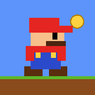

<div align="center">



# 🍄 SUPER RUNNER INFINI

**Le runner 2D sans fin façon Super Mario Bros × Subway Surfers**
Ordinateur · Mobile · Installable · Jouable hors ligne


### ▶ [Jouer maintenant](https://TON-PSEUDO.github.io/NOM-DU-DEPOT/)

</div>

---

## ✨ Nouveautés de la v4.5

| | |
|---|---|
| 🎨 **Graphismes refinés** | Ciels plus doux, collines par zones, nuages, herbe détaillée, fleurs |
| ✨ **Menus fluides** | Glassmorphism, animations plus souples, boutons arrondis et réactifs |
| 🌅 **Ambiances de zone** | Jour lumineux · Coucher de soleil chaud · Nuit étoilée · Forêt verdoyante |
| 👤 **Boutique de personnages** | Costumes dans une boutique dédiée |
| ⚡ **Boutique d’améliorations** | Upgrades séparés (double saut, aimant+, bouclier…) |

## ✨ Nouveautés de la v4.3

| | |
|---|---|
| 🎬 **Menus animés** | Transitions fluides, titre flottant, boutons réactifs, écran d'aide |
| 🏃 **Animations pro** | Squash & stretch, ombre, poussière, particules qui s'estompent |
| ⏱️ **Compte à rebours** | 3 · 2 · 1 · GO ! avant chaque partie |
| 🔥 **Combos** | Écrase les ennemis à la chaîne : ×2, ×3, ×4… |
| 📊 **HUD moderne** | Pastilles arrondies, barre de progression de zone, barres de bonus |
| 🎵 **Musique chiptune** | Qui s'accélère avec la vitesse du jeu |
| 💥 **Game feel** | Flash, tremblement d'écran, vibration mobile, traits de vitesse |
| 🏆 **Records** | Badge « Nouveau record » en fin de partie |

## 🎮 Fonctionnalités

- **Génération infinie** : la vitesse augmente avec la distance
- **4 zones** : jour → coucher de soleil → nuit → forêt
- **Obstacles variés** : trous, tuyaux, briques, ennemis, oiseaux
- **Bonus** : 🧲 aimant · 🛡️ bouclier · 🪙 pièces ×2 · ⭐ étoile invincible
- **Boutique d’améliorations** : double saut, aimant+, bouclier de départ, pièces dorées
- **Boutique de personnages** : 5 costumes (Classique, Vert, Violet, Cyan, Or)
- **Sauvegarde automatique** : pièces, achats, record
- **PWA** : installable sur l'écran d'accueil, fonctionne sans connexion

## 📱 Version mobile

- Mise en page **verticale automatique** quand le téléphone est en portrait (le jeu reste horizontal sur ordinateur et en paysage)
- Multi-touch : saute et baisse-toi en même temps (gauche = se baisser, droite = sauter)
- Rendu net sur écrans Retina / HiDPI, écran maintenu allumé, pause automatique si tu quittes l'app
- Bouton « 📲 Installer » (Android) ou *Partager → Sur l'écran d'accueil* (iPhone)

## 🤖 APK Android

Le bouton **📲 Installer l'app** (menu, sur Android) télécharge l'APK du jeu.
L'APK est construit **automatiquement par GitHub** (`.github/workflows/apk.yml`) à chaque push, puis publié dans *Releases → APK Android*.

- Premier build : 5 à 10 min après le push (onglet *Actions*)
- Lien direct : `https://github.com/TON-PSEUDO/NOM-DU-DEPOT/releases/latest/download/super-runner-infini.apk`
- Sur le téléphone : autorise l'installation depuis le navigateur, puis ouvre le fichier

## 🕹️ Commandes

| Action | Clavier | Mobile |
|---|---|---|
| Sauter *(maintenir = plus haut)* | `Espace` · `↑` · `W` | toucher à droite |
| Se baisser | `↓` · `S` | toucher à gauche |
| Pause | `P` · `Échap` | bouton ⏸ |
| Plein écran | `F` | — |

## 🚀 Publier en un clic

1. Installe [Git](https://git-scm.com/downloads) (et, idéalement, la CLI [`gh`](https://cli.github.com)).
2. **Windows** : double-clique sur `push.bat` · **Mac / Linux** : `./push.sh`
3. Première fois seulement : **Settings → Pages → Source : GitHub Actions**

Avec `gh` connecté, le script crée le dépôt et active Pages automatiquement.
Ensuite, chaque lancement met le site à jour (déploiement via `.github/workflows/pages.yml`).

## 🧪 Tester en local

```bash
python3 -m http.server 8000
# puis ouvre http://localhost:8000
```

## 🗂️ Structure

```
.
├── index.html               # le jeu complet (HTML + CSS + JS)
├── sw.js                    # service worker (hors ligne)
├── manifest.webmanifest     # configuration PWA
├── icon.svg · icon-*.png    # icônes
├── 404.html · robots.txt
├── push.bat · push.sh       # publication directe sur GitHub
└── .github/workflows/
    └── pages.yml            # déploiement GitHub Pages
```

## 🛣️ Idées pour la suite

- [ ] Missions quotidiennes
- [ ] Classement en ligne
- [ ] Sprites pixel-art animés
- [ ] Nouveaux ennemis et boss de zone

## 📄 Licence

MIT, voir [`LICENSE`](LICENSE).

<div align="center"><sub>Fait avec ❤️ et beaucoup de pièces 🪙</sub></div>
